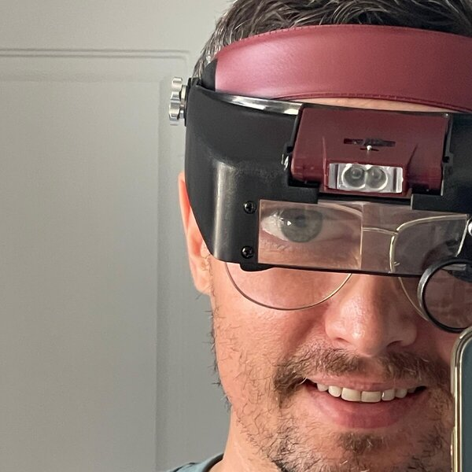

# Wyszukiwanie agentowe a strony i sklepy internetowe

Artykuł o tym, czym jest wyszukiwanie agentowe, czyli wyszukiwanie, w którym asystent AI sam wykonuje zadanie na stronie zamiast pokazywać listę linków. Opisuje, jak agent czyta stronę (drzewo dostępności, HTML, dane strukturalne, llms.txt, robots.txt z Content-Signal, Agent Readiness Cloudflare) i co z tego wynika dla sklepów (UCP, ACP). Zawiera pomiary czterech stron z 5 listopada 2026 (PageSpeed Insights, kategoria przeglądania agentowego, sygnały sprawdzone poleceniem `curl`), listę 8 rzeczy do zrobienia i 19 źródeł.

**Autor:** Piotr Czwarnowski, EcoPower Polska Sp. z o.o.  
**Data:** 5 listopada 2026  
**Wersja kanoniczna:** <https://www.ecopowerpolska.pl/blog/wyszukiwanie-agentowe-strony-i-sklepy/>

 

## Pliki

| Plik | Zawartość |
|---|---|
| [`wyszukiwanie-agentowe-strony-i-sklepy.md`](wyszukiwanie-agentowe-strony-i-sklepy.md) | pełny artykuł po polsku (oryginał) |
| [`agentic-search-websites-and-online-stores.md`](agentic-search-websites-and-online-stores.md) | pełne tłumaczenie na angielski |
| [`ZRODLA.md`](ZRODLA.md) | lista źródeł z autorami, adresami i licencjami repozytoriów |
| [`obrazy/`](obrazy/) | zdjęcia i zrzuty raportów użyte w artykule, zdjęcie autora |
| [`LICENSE`](LICENSE) | pełny tekst licencji CC BY 4.0 |
| [`NOTICE`](NOTICE) | nota o prawach: autor tekstu i wyłączenia obrazów spod CC BY 4.0 |

## Licencja

Tekst artykułu (wersja polska i angielska), tabele pomiarów, lista kontrolna i zdjęcie autora: © Piotr Czwarnowski 2026, licencja [Creative Commons Uznanie autorstwa 4.0 Międzynarodowe (CC BY 4.0)](https://creativecommons.org/licenses/by/4.0/deed.pl). Możesz kopiować, zmieniać i rozpowszechniać ten materiał, także komercyjnie, pod warunkiem podania autora, źródła i licencji.

### Licencja obrazów

Nie wszystkie obrazy w katalogu `obrazy/` podlegają CC BY 4.0:

| Plik | Pochodzenie | Licencja |
|---|---|---|
| `autor.jpg` | zdjęcie autora | © Piotr Czwarnowski 2026, CC BY 4.0 |
| `wyszukiwanie-agentowe-asystent-ai.jpg` | zdjęcie stockowe z Canvy (Canva Free) | **nie podlega CC BY 4.0**, licencja Canvy; do użycia wyłącznie w tym artykule |
| `wyszukiwanie-agentowe-asystent-glosowy.jpg` | zdjęcie stockowe z Canvy (Canva Free) | **nie podlega CC BY 4.0**, licencja Canvy; do użycia wyłącznie w tym artykule |
| `wyszukiwanie-agentowe-psi-studioagat-przed-2026-10-14.png` | zrzut raportu PageSpeed Insights (narzędzie Google) | zrzut ekranu narzędzia Google z wynikami pomiaru autora |
| `wyszukiwanie-agentowe-psi-studioagat-po-2026-11-05.png` | zrzut raportu PageSpeed Insights (narzędzie Google) | zrzut ekranu narzędzia Google z wynikami pomiaru autora |
| `wyszukiwanie-agentowe-lighthouse-ecopowerpolska-agentic.png` | zrzut raportu Lighthouse (narzędzie Google) | zrzut ekranu narzędzia Google z wynikami pomiaru autora |

Dwa zdjęcia stockowe z Canvy nie wchodzą w zakres licencji CC BY 4.0 tego repozytorium. Kto kopiuje artykuł, powinien je pominąć albo zastąpić własnymi.

## Jak cytować

> Czwarnowski P., Wyszukiwanie agentowe a strony i sklepy internetowe, 2026-11-05, ecopowerpolska.pl, GitHub: https://github.com/ecopowerpolska/wyszukiwanie-agentowe

---

## English

# Agentic search, websites and online stores

An article on agentic search, in which an AI assistant carries out a task on a website instead of showing a list of links. It explains how an agent reads a page (accessibility tree, HTML, structured data, llms.txt, robots.txt with Content Signals, Cloudflare Agent Readiness) and what follows for online stores (UCP, ACP). It includes measurements of four websites taken on 5 November 2026 (PageSpeed Insights agentic browsing category, signals checked with `curl`), a checklist of 8 things to do and 19 sources.

**Author:** Piotr Czwarnowski, EcoPower Polska Sp. z o.o. · **Date:** 5 November 2026 · **Canonical (Polish) version:** <https://www.ecopowerpolska.pl/blog/wyszukiwanie-agentowe-strony-i-sklepy/>

**Files:** [`wyszukiwanie-agentowe-strony-i-sklepy.md`](wyszukiwanie-agentowe-strony-i-sklepy.md) (Polish original), [`agentic-search-websites-and-online-stores.md`](agentic-search-websites-and-online-stores.md) (full English translation), [`ZRODLA.md`](ZRODLA.md) (sources), [`obrazy/`](obrazy/) (images), [`LICENSE`](LICENSE) (CC BY 4.0), [`NOTICE`](NOTICE) (copyright and image exceptions).

### Licence

Text (Polish and English), measurement tables, checklist and author photo: © Piotr Czwarnowski 2026, [CC BY 4.0](https://creativecommons.org/licenses/by/4.0/).

### Image licences

The two stock photos from Canva Free (`wyszukiwanie-agentowe-asystent-ai.jpg`, `wyszukiwanie-agentowe-asystent-glosowy.jpg`) are **not** covered by CC BY 4.0; they are used under Canva's licence for this article only. The three PNG files are screenshots of Google tools (PageSpeed Insights, Lighthouse) showing the author's measurements.

### How to cite

> Czwarnowski P., Wyszukiwanie agentowe a strony i sklepy internetowe [Agentic search, websites and online stores], 2026-11-05, ecopowerpolska.pl, GitHub: https://github.com/ecopowerpolska/wyszukiwanie-agentowe
