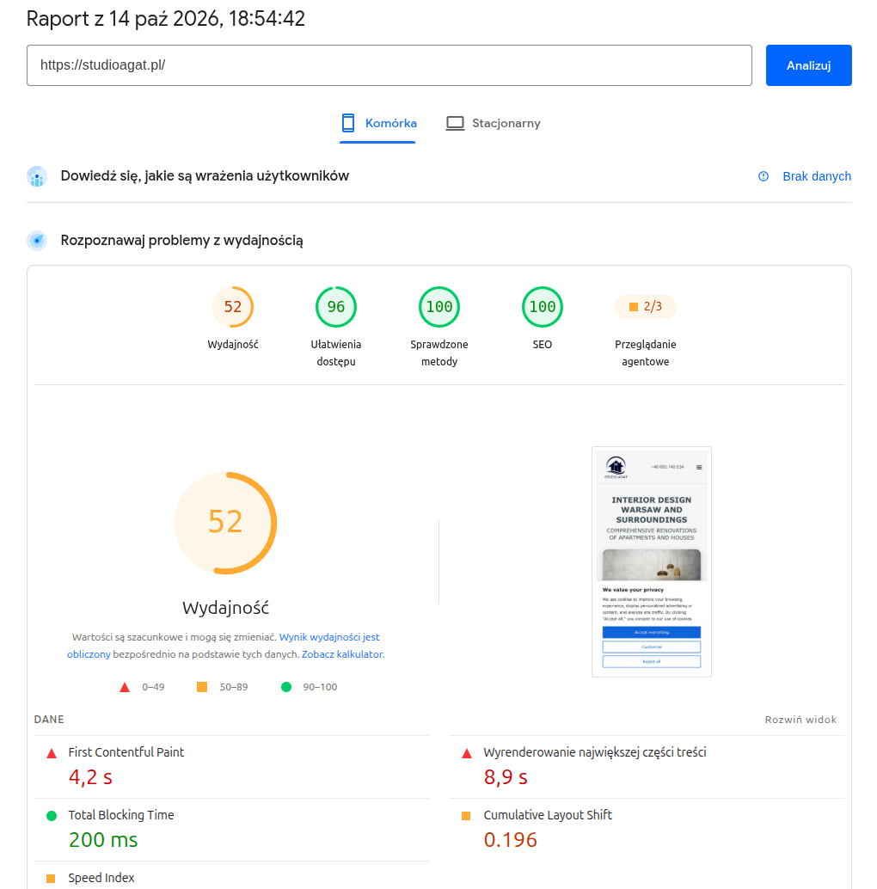
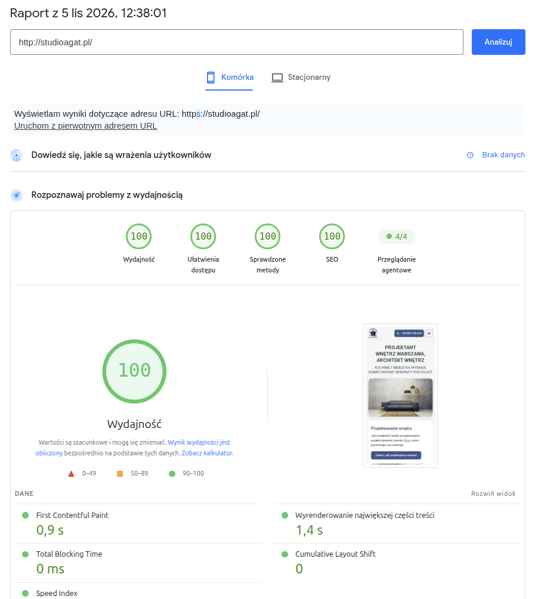
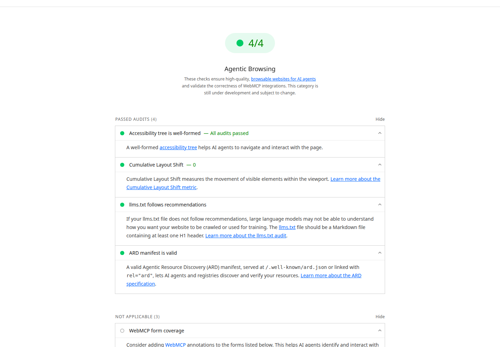

# Agentic search, websites and online stores

**Agentic search: an AI assistant acts on your website and in your store by itself**

Author: **Piotr Czwarnowski**, EcoPower Polska Sp. z o.o.  
Published: 5 November 2026  
Canonical version (Polish): <https://www.ecopowerpolska.pl/blog/wyszukiwanie-agentowe-strony-i-sklepy/>  
Translated from the Polish original: [wyszukiwanie-agentowe-strony-i-sklepy.md](wyszukiwanie-agentowe-strony-i-sklepy.md)  
Text licence: [CC BY 4.0](LICENSE) (image licences: [README](README.md#image-licences))


*Illustrative photo: a phone with an AI assistant open (Canva, stock photo).*

Agentic search is search in which the AI assistant does not show a list of links but carries out the task itself. It looks for an available slot, compares offers, fills in a form. Google already searches for free restaurant tables this way (1), and Lighthouse scores websites in a new category for agents (10). That is why it already matters whether an agent will understand your website. Below I describe how an agent reads it, what I measured on 5 November 2026, and what to do on a website and in an online store.

## Agentic search: the agent carries out a task instead of reading results

In ordinary search you get a list of pages and click through them yourself. An agent gets a task, for example "find a table for Thursday at 7 pm". It goes through the pages by itself and comes back with a result or a form to approve. Your website is then read by a program that has to do something on it.

What you are dealing with today:

- **Google AI Mode.** Has had agentic features since 21 August 2025. It started with restaurant reservations: it searches many platforms, shows available times and takes you to the booking page. There a human completes the reservation. Partners include OpenTable, Resy and Tock (1). Underneath it runs Project Mariner browsing and data from the Knowledge Graph and Google Maps (2). At launch the feature went to AI Ultra subscribers in the USA (1).
- **ChatGPT agent (OpenAI).** Since 17 July 2025 it combines two earlier tools. Operator clicked through web pages, Deep Research gathered knowledge from many sites. OpenAI turned off the agent's memory for fear of data exfiltration through prompt injection (4).
- **Perplexity Comet.** A browser with an agent in a side panel that sees the open page. The TechCrunch reviewer praised it for simple tasks. When booking parking, however, the agent entered the wrong dates (5).
- **Claude in Chrome (Anthropic).** An agent that works in the Chrome browser. In August 2025 it launched as a pilot for 1,000 users of the Max plan (6).

Agents still make mistakes. TechCrunch describes their real-world performance as brittle (4). Prompt injection is a hidden instruction on a page that tries to take over the agent. Anthropic tested its extension on 123 test cases across 29 attack scenarios. Without safeguards the attack succeeded in 23.6% of attempts. With safeguards, in autonomous mode, in 11.2% (6). The takeaway for a website: the simpler and better described it is, the less room there is for an agent to make a mistake.


*Illustrative photo: talking to a voice assistant on a phone.*

## How an agent reads a website

An agent uses several layers of a page at once. I describe them in the order in which I check them.

### The accessibility tree

The accessibility tree is a simplified map of the page that the browser builds. Every button, field and link has a role and a name in it. In the agentic browsing category Lighthouse checks these names and labels, the correctness of the tree and the visibility of elements (10). A button without a name or a field without a label is a puzzle for an agent.

### Ready HTML instead of content rendered by a script

Our websites reach the browser as ready HTML from Astro. Content and forms are in the code straight away, without waiting for a script. Google says plainly that AI features in Search have no additional technical requirements. The page has to be indexed and eligible to be shown with a snippet in search results (11).

### Structured data

JSON-LD structured data describes a company, a service or a product in the schema.org vocabulary. Google requires it to match the text visible on the page. No special types are needed for AI Overviews and AI Mode (11). NLWeb, an open Microsoft project, is built on schema.org data. Each of its instances works as an MCP (Model Context Protocol) server, that is, a source of tools for an AI model (15).

However, I did not find a Google or Bing document that says directly that an agent reads JSON-LD.

### The llms.txt file

llms.txt is a proposal by Jeremy Howard of Answer.AI from 3 September 2024 (12). The file sits in the root directory and is written in Markdown. Only an H1 heading with the name is required. It is followed by a summary in a blockquote and H2 sections with lists of links (12). It is a proposal, not a standard.

Google Search does not require it (11), Lighthouse checks it (10), and the Cloudflare scanner skips it by default (7). My view: llms.txt helps agents, but it is not a condition for visibility in Google.

### robots.txt, Content-Signal and bot signatures

Content-Signal is a line in robots.txt that Cloudflare described in September 2025. It states what the site's content may be used for (8):

- `search`: building a search index and showing results with links and snippets,
- `ai-input`: using the content in an AI answer to the current question,
- `ai-train`: training and fine-tuning models.

Cloudflare adds it to the managed robots.txt of more than 3.8 million domains (8). On our sites the group for the OpenAI bot looks like this:

```text
User-agent: GPTBot
Allow: /
Disallow: /admin/
Content-Signal: search=yes, ai-input=yes, ai-train=yes
```

I put the Content-Signal line under every User-agent group. A bot with its own group reads only that group, so a signal placed only in the general group would not reach it.

The Web Bot Auth draft proposes that a bot signs its HTTP requests and the server verifies the signature (14). The authors are Thibault Meunier of Cloudflare and Sandor Major of Google. It is an individual IETF draft, not a standard (14).

### Cloudflare Agent Readiness and Markdown for agents

In April 2026 Cloudflare launched a score of how ready a website is for agents. It looks at four dimensions (7):

1. **Discoverability:** robots.txt, sitemap.xml and Link headers.
2. **Content:** a Markdown version for agents.
3. **Bot access control:** Content Signals, rules for AI bots and Web Bot Auth.
4. **Capabilities:** Agent Skills, an API catalog, OAuth discovery, MCP Server Card and WebMCP.

Along the way Cloudflare examined the 200,000 most popular domains. 78% of them have a robots.txt file, but only 4% declare their preferences towards AI (7). 3.9% of sites pass Markdown negotiation (7). It means that in response to the `Accept: text/markdown` header the server returns Markdown instead of HTML.

A token is a piece of text in which a model counts its work. According to Cloudflare, Markdown can cut token usage by up to 80% in some cases. On Cloudflare's documentation an agent used on average 31% fewer tokens and worked 66% faster (7). Fewer than 15 sites in the whole sample had an MCP Server Card and an API catalog combined (7).

### How much traffic AI bots generate

Cloudflare Radar counted traffic from 1 January to 2 December 2025 (9). AI bots accounted on average for 4.2% of HTML page requests. Googlebot accounted for 4.5%, and humans for 47% (9).

The crawl-to-refer ratio is more interesting. It says how many pages a bot fetches for each click that comes back to the site. For Anthropic it reached 500,000 to 1, for OpenAI at most 3,700 to 1. Perplexity has been below 200 to 1 since September 2025 (9). The ChatGPT-User bot, which acts on a user's request, had at its peak 16 times more traffic than at the start of the year (9).

## What I measured on four of our websites

I measure four websites that we have built and run: www.ecopowerpolska.pl, studioagat.pl, pan-stolarz.pl and nadihome.pl.

### Studio Agat before and after the move

On 14 October 2026 studioagat.pl was still running on WordPress. Two days later we moved it to Astro. Both measurements are PageSpeed Insights on mobile (I measured on 14 October and 5 November 2026).

| Mobile test result | 14 October 2026, WordPress | 5 November 2026, Astro |
|---|---|---|
| Performance | 52 | 100 |
| Accessibility | 96 | 100 |
| Best Practices | 100 | 100 |
| SEO | 100 | 100 |
| Agentic browsing | 2/3 | 4/4 |
| First Contentful Paint | 4.2 s | 0.9 s |
| Largest Contentful Paint | 8.9 s | 1.4 s |
| Total Blocking Time | 200 ms | 0 ms |
| Cumulative Layout Shift | 0.196 | 0 |


*PageSpeed Insights report of 14 October 2026: studioagat.pl on WordPress, performance 52 and agentic browsing 2/3 (Polish-language report).*


*PageSpeed Insights report of 5 November 2026: studioagat.pl on Astro, four scores of 100 and agentic browsing 4/4 (Polish-language report).*

Two things I have to point out. In October the agentic browsing category had three audits; today it has four. Google has extended it, so 2/3 and 4/4 are two different scales. The October screenshot does not show which audit failed at the time.

Second: in the same minute, a measurement through the PageSpeed API gave studioagat.pl 98 on mobile (I measured on 5 November 2026). The performance score varies between runs.

### Four websites in one measurement

On 5 November 2026 I measured four websites through the PageSpeed Insights API (Lighthouse 13.6.0). Each on mobile and on desktop, all within two seconds.

| Website | Performance, mobile | Performance, desktop | Accessibility | Best Practices | SEO | Agentic browsing |
|---|---|---|---|---|---|---|
| www.ecopowerpolska.pl | 99 | 100 | 100 | 100 | 100 | 4/4 |
| studioagat.pl | 98 | 100 | 100 | 100 | 100 | 4/4 |
| pan-stolarz.pl | 99 | 100 | 100 | 100 | 100 | 4/4 |
| nadihome.pl | 99 | 100 | 100 | 100 | 100 | 4/4 |

On mobile LCP was 1.0 s on three sites and 1.4 s on studioagat.pl. TBT was 0 ms everywhere except pan-stolarz.pl on mobile (10 ms). CLS was 0, except nadihome.pl on desktop (0.001).

### The four agentic audits in plain words


*Lighthouse report from the PageSpeed Insights measurement of 5 November 2026: www.ecopowerpolska.pl on desktop, four agentic audits passed.*

Four audits count towards the score (I measured on 5 November 2026):

1. **The accessibility tree is valid.** Every button, field and link has a role and a name. The agent moves around the page and clicks using this tree.
2. **Cumulative Layout Shift.** Elements do not move while the page loads. Lighthouse counts this stability towards a page's readiness for agents (10).
3. **llms.txt follows the recommendations.** The file is Markdown and has at least one H1 heading. The audit checks the form of the file, not its content.
4. **The ARD manifest is valid.** ARD (Agentic Resource Discovery) is the file `/.well-known/ard.json` or a file pointed to with the `rel="ard"` attribute. According to the audit description it lets agents and registries find and verify a site's resources.

Three WebMCP audits have a weight of 0 and, on our sites, the status "not applicable", because we do not implement WebMCP. Google describes the whole category as still evolving and subject to change.

### Signals I checked with curl

I did the second part of the measurement with the `curl` command. You can repeat it on your own website:

```bash
curl -s https://studioagat.pl/robots.txt | grep -i content-signal
curl -s -o /dev/null -w '%{http_code} %{content_type}\n' https://studioagat.pl/llms.txt
curl -s -o /dev/null -w '%{http_code}\n' https://studioagat.pl/.well-known/ard.json
curl -s -o /dev/null -w '%{content_type}\n' -H 'Accept: text/markdown' https://studioagat.pl/
```

| Signal | www.ecopowerpolska.pl | studioagat.pl | pan-stolarz.pl | nadihome.pl |
|---|---|---|---|---|
| Content-Signal in robots.txt | yes | yes | yes | yes |
| GPTBot, ClaudeBot, PerplexityBot | allowed | allowed | allowed | allowed |
| /llms.txt | 200 | 200 | 200 | 200 |
| /llms-full.txt | 404 | 404 | 404 | 200 |
| /.well-known/ard.json | 200 | 200 | 200 | 200 |
| Markdown on `Accept: text/markdown` | no | no | no | no |
| JSON-LD on the home page | Organization, LocalBusiness, 11 services with an offer | LocalBusiness, 5 services with an offer | LocalBusiness, 4 services with an offer | LocalBusiness, no services |

Two things come out poorly and I say so openly. Only nadihome.pl has the full content in llms-full.txt; the other three sites return 404. None of the four sites supports Markdown negotiation: on `Accept: text/markdown` each one returns HTML. In the Cloudflare study we are therefore on the side of the majority, not among those 3.9% (7).

## 8 things to do on a website and in an online store

1. **Semantic HTML and forms not gated behind a script.** Every field has a label, every button a name, and the form works without JavaScript. Script gating means content or a form that appears only after a script runs. You can check this with the accessibility tree audit in PageSpeed Insights (10) and by submitting the form with JavaScript turned off.
2. **JSON-LD structured data.** Company website: Organization or LocalBusiness. Online store: Product with Offer for every product. The data has to match the visible text (11). You can check it in the page source, in the `<script type="application/ld+json">` block.
3. **The llms.txt file.** In the root directory, in Markdown: an H1 with the name, a summary in a blockquote, H2 sections with links (12). You can check it with the llms.txt audit in PageSpeed Insights (10).
4. **A decision about AI bots in robots.txt.** Add Content-Signal with the three signals (8), under every User-agent group. You can check it with `curl` on the `/robots.txt` address.
5. **ARD manifest.** The file `/.well-known/ard.json` describes the site's resources for agents and registries. You can check it with the "ARD manifest is valid" audit in PageSpeed Insights (I measured on 5 November 2026).
6. **Speed and a CLS of 0.** Lighthouse counts layout stability in the agentic category (10). You can check it in PageSpeed Insights, separately on mobile and on desktop.
7. **A product feed, and in a store, preparation for UCP and ACP.** A complete feed in Google Merchant Center is the foundation, and Google is adding dozens of new attributes to it (3). Check that the feed covers all products and has the same prices as the store.
8. **WebMCP: watch it.** It is a W3C community group draft, not a standard. It lets a website expose tools written in JavaScript to agents (13). Will Huang showed in AgentReady.js how a single `<script>` tag turns semantic HTML into such tools. It leaves purchases and form submissions to a human for approval (18).

## Online stores: UCP, ACP and a payment token for the agent

On 11 January 2026 Google announced the Universal Commerce Protocol, UCP for short (3). It is an open standard for the whole purchase journey. It works together with the A2A, AP2 and MCP protocols. It was co-developed by Shopify, Etsy, Wayfair, Target and Walmart. More than 20 companies have endorsed it, including Visa, Mastercard, Stripe and Zalando (3). The store, not Google, remains the seller. Payment in AI Mode is to go through Google Pay, in the USA and "soon" (3).

Earlier, on 29 September 2025, Stripe and OpenAI presented the Agentic Commerce Protocol, ACP (16). It is also an open standard. A seller integrates with it once. A store without Stripe can implement it with its own payment provider (16).

The most interesting part of ACP is the Shared Payment Token. It works only with one seller and only for the amount of one cart. It does not reveal the card details to either the store or the agent (16). At launch, users in the USA bought from Etsy sellers through ChatGPT (16).

What does this mean for a small online store in Poland? Both protocols launched in the USA (3, 16), and none of the sources gives a date for Poland. So I do not promise that an agent will buy in your store this year. You can already put your product data, feed and forms in order. The same work helps in ordinary search.

## Frequently asked questions

### Does Google require an llms.txt file?

No. Google Search Central says that AI features in Search have no additional technical requirements. No separate files or markup for AI are needed. The page has to be indexed and eligible to be shown with a snippet in search results (11). Lighthouse, on the other hand, checks llms.txt in the agentic browsing category (10). That is why we have it, but we do not treat it as a condition for visibility in Google.

### Will an agent buy in my store today?

Through a protocol, probably not yet. UCP and ACP work in the USA, and Google announces payment in AI Mode as coming "soon" (3, 16). An agent in a browser, such as Comet, sees the open page and can act on it. Reviews, however, describe mistakes, for example wrong dates (5). Tools such as AgentReady.js leave the purchase to a human for approval (18).

### Should I block AI bots?

It is the owner's decision, not a technical matter. Content-Signal lets you split it into three permissions: search, AI answers and model training (8). The Google-Extended token limits the use of content for training Google models (11). Radar data shows that some bots fetch hundreds of thousands of pages for each referral (9). We keep our websites open because they are meant to be found.

### Does agentic search replace SEO?

No. For AI features Google requires from websites the same as for ordinary results: being indexed and eligible for a snippet (11). The GEO paper, on optimisation for generative engines, showed up to 40% higher visibility in their answers (17). That is a research result, not a guarantee for your website. The effectiveness of the methods depended on the domain there (17).

## Where to start

Start with what helps people and agents at the same time: the accessibility tree and forms that are not gated behind a script. Then structured data, llms.txt and the decision about bots in robots.txt. Finally, measure the website in PageSpeed Insights, for example with [our website speed test](https://www.ecopowerpolska.pl/jak-sprawdzic-szybkosc-strony/) (in Polish). You can check the signals for agents, that is llms.txt, robots.txt, the ARD manifest and structured data, with our free [AI and agentic search audit](https://www.ecopowerpolska.pl/narzedzia/wyszukiwanie-agentowe-ai/) (in Polish). Watch WebMCP and the commerce protocols, but do not rebuild your website for them today. Measurement results for all our websites are in the [our projects](https://www.ecopowerpolska.pl/#realizacje) section (in Polish).

## About the author


**Piotr Czwarnowski**, EcoPower Polska Sp. z o.o. We build and run websites and online stores for businesses. [Contact us](https://www.ecopowerpolska.pl/kontakt/).

<br clear="left">

## Sources

Source descriptions below are translated from the Polish original; the links lead to the documents with their original titles.

1. Robby Stein (Google), [AI Mode: agentic features and personalisation](https://blog.google/products-and-platforms/products/search/ai-mode-agentic-personalized/), 21 August 2025.
2. 9to5Google, [Google AI Mode in new countries and with agentic features](https://9to5google.com/2025/08/21/google-ai-mode-countries-agentic/), 21 August 2025.
3. Vidhya Srinivasan (Google), [Agentic commerce and the Universal Commerce Protocol](https://blog.google/products/ads-commerce/agentic-commerce-ai-tools-protocol-retailers-platforms/), 11 January 2026.
4. Maxwell Zeff (TechCrunch), [OpenAI launches a general-purpose agent in ChatGPT](https://techcrunch.com/2025/07/17/openai-launches-a-general-purpose-agent-in-chatgpt/), 17 July 2025.
5. Maxwell Zeff (TechCrunch), [Perplexity launches Comet, an AI-powered web browser](https://techcrunch.com/2025/07/09/perplexity-launches-comet-an-ai-powered-web-browser/), 9 July 2025.
6. Anthropic, [Claude for Chrome](https://claude.com/blog/claude-for-chrome), 25 August 2025, updated 24 November and 18 December 2025.
7. Cloudflare, [Agent Readiness](https://blog.cloudflare.com/agent-readiness/), 17 April 2026, revised 15 July 2026.
8. Will Allen (Cloudflare), [Content Signals Policy](https://blog.cloudflare.com/content-signals-policy/), 24 September 2025. The policy is licensed under CC0.
9. Cloudflare, [Radar 2025 Year in Review](https://blog.cloudflare.com/radar-2025-year-in-review), data from 1 January to 2 December 2025.
10. Chrome for Developers (Google), [Lighthouse: Agentic Browsing](https://developer.chrome.com/docs/lighthouse/agentic-browsing), no date on the page, read on 5 November 2026.
11. Google Search Central, [AI features and your website](https://developers.google.com/search/docs/appearance/ai-features), no date on the page, read on 5 November 2026.
12. Jeremy Howard (Answer.AI), [llms.txt](https://llmstxt.org/), 3 September 2024. Repository [AnswerDotAI/llms-txt](https://github.com/AnswerDotAI/llms-txt), Apache-2.0 licence.
13. Web Machine Learning Community Group (W3C), editors Brandon Walderman and Samuel Dallstream (Microsoft) and Khushal Sagar and Dominic Farolino (Google), [WebMCP, Draft Community Group Report](https://webmachinelearning.github.io/webmcp/), version of 2 November 2026. Repository [webmachinelearning/webmcp](https://github.com/webmachinelearning/webmcp).
14. Thibault Meunier (Cloudflare) and Sandor Major (Google), [Web Bot Auth, IETF draft](https://datatracker.ietf.org/doc/draft-meunier-web-bot-auth-architecture/), version 05 of 2 March 2026. Repository [cloudflare/web-bot-auth](https://github.com/cloudflare/web-bot-auth), Apache-2.0 licence.
15. nlweb-ai (Microsoft), [NLWeb](https://github.com/nlweb-ai/NLWeb), announced 19 May 2025, MIT licence.
16. Stripe, [Instant Checkout and the Agentic Commerce Protocol](https://stripe.com/newsroom/news/stripe-openai-instant-checkout), 29 September 2025.
17. Pranjal Aggarwal, Vishvak Murahari, Tanmay Rajpurohit, Ashwin Kalyan, Karthik Narasimhan, Ameet Deshpande, [GEO: Generative Engine Optimization](https://arxiv.org/abs/2311.09735), KDD 2024, CC BY 4.0 licence. Repository [GEO-optim/GEO](https://github.com/GEO-optim/GEO), Apache-2.0 licence.
18. Will Huang, [AgentReady.js](https://github.com/doggy8088/agentready), MIT licence.
19. Own measurements: PageSpeed Insights report for studioagat.pl of 14 October 2026, PageSpeed Insights API measurement (Lighthouse 13.6.0) of four websites and a check of signals with `curl` on 5 November 2026.
