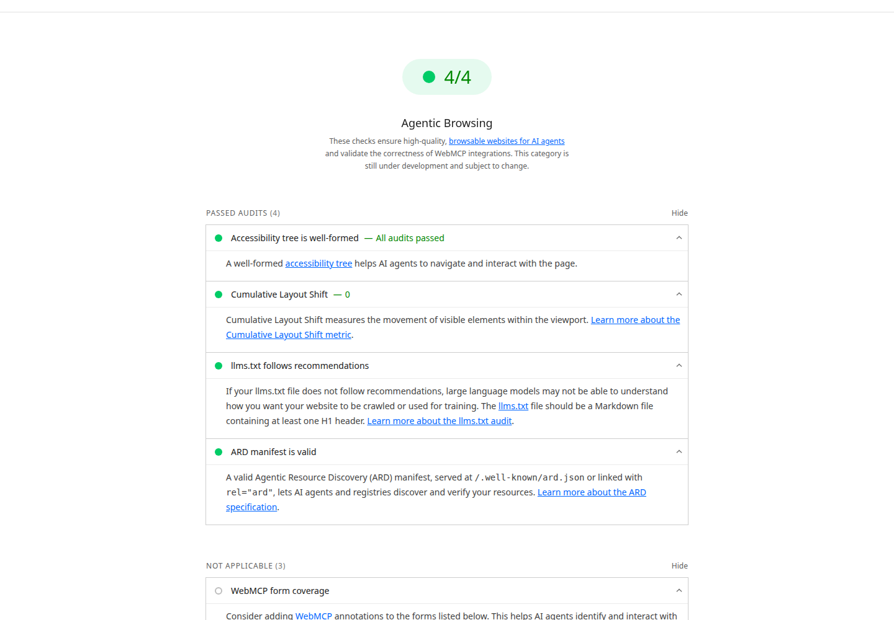
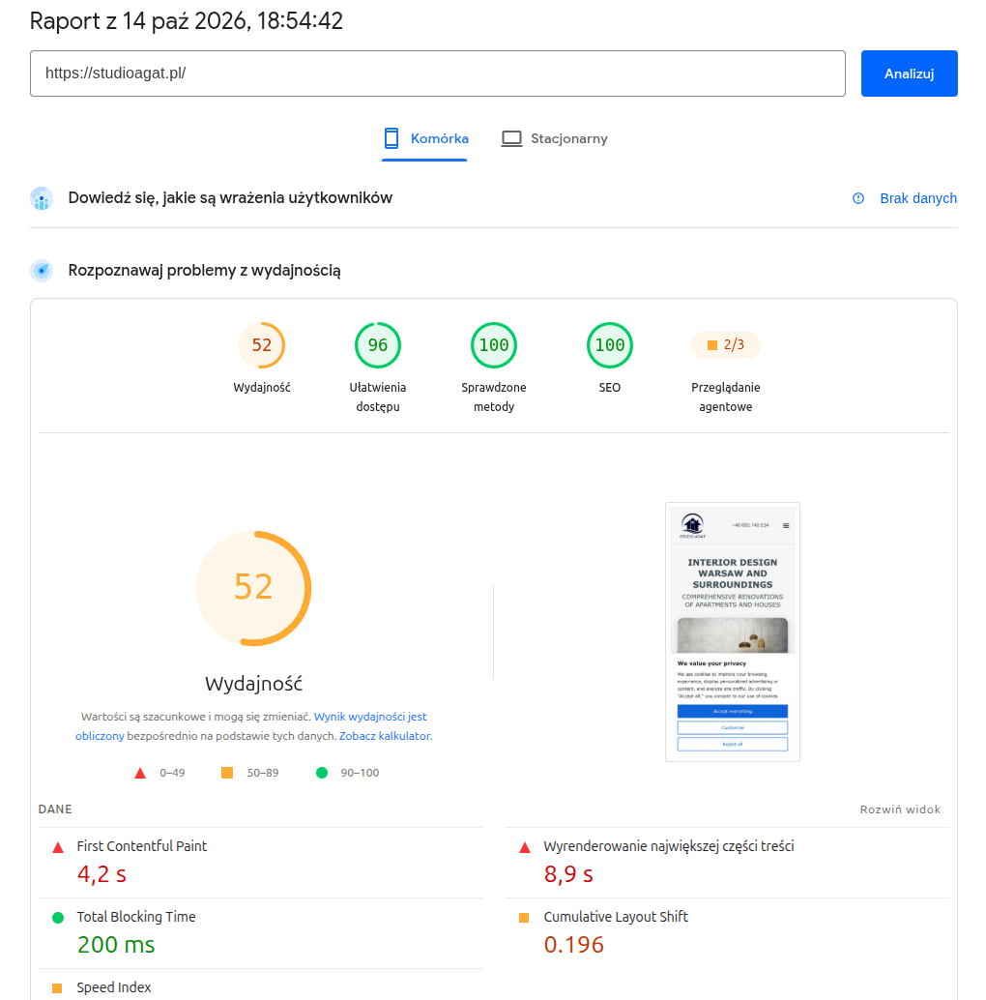
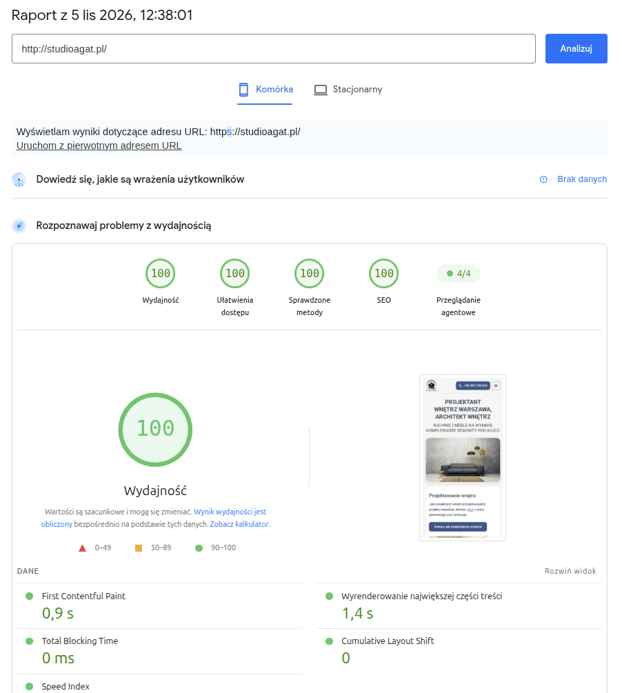

# Wyszukiwanie agentowe a strony i sklepy internetowe: warstwy, pomiar, lista kontrolna

Autor: **Piotr Czwarnowski**  
Data: 5 listopada 2026  
Licencja: [CC BY 4.0](LICENSE)  
English version: [agentic-search-websites-and-online-stores.md](agentic-search-websites-and-online-stores.md)  
Wersja na blogu: <https://www.ecopowerpolska.pl/blog/wyszukiwanie-agentowe-strony-i-sklepy/>  
Hasło w Wikipedii: <https://pl.wikipedia.org/wiki/Wyszukiwanie_agentowe>

Dokument techniczny dla osób, które budują albo utrzymują strony i sklepy. Numery w nawiasach, np. (17), odsyłają do listy źródeł w sekcji 9. Surowe wyniki pomiarów leżą w katalogu [`pomiary/`](pomiary/), skrypt kontroli w [`skrypty/`](skrypty/), przykładowe pliki w [`przyklady/`](przyklady/).

## 0. Streszczenie

„Gotowość strony na agentów AI” to w praktyce trzy różne cele: widoczność w wyszukiwaniu z AI, obsługa strony przez agenta przeglądarkowego i zakupy przez protokoły; każdy ma inne wymagania i inną miarę. Dla AI Overviews i AI Mode dokumentacja Google nie stawia wymagań ponad zwykłe indeksowanie i kwalifikację do fragmentu, a osobnych plików dla AI nie wymaga (17). Agent przeglądarkowy korzysta z tego samego co technologie asystujące, czyli z drzewa dostępności, etykiet i stabilnego układu; Lighthouse sprawdza to w eksperymentalnej kategorii Agentic Browsing (15). llms.txt, ARD, WebMCP, Web Bot Auth i Content-Signal to propozycje, szkice albo deklaracje bez technicznego wymuszenia, a zaliczony audyt nie oznacza, że jakikolwiek agent z nich korzysta. Dokument opisuje warstwy, metodologię i wyniki pomiaru czterech stron z 5 listopada 2026, skrypt do kontroli sygnałów oraz listę kontrolną dla strony i sklepu.

## 1. Trzy cele, nie jedna „gotowość agentowa”

Pod hasłem „wyszukiwanie agentowe” mieszają się trzy rzeczy. Pliki i manifesty z jednej kolumny nie poprawiają wyników w drugiej, więc warto je rozdzielić przed pierwszą zmianą w kodzie.

1. **Widoczność w wyszukiwaniu z AI** (AI Overviews, AI Mode, ChatGPT Search). System AI pobiera stronę, streszcza ją i cytuje. Google pisze, że strona ma być zindeksowana i kwalifikować się do wyświetlenia z fragmentem, a dodatkowych wymagań technicznych nie ma (17). Praca o GEO (Generative Engine Optimization) zmierzyła do 40% większą widoczność w odpowiedziach silników generatywnych, ze skutecznością metod zależną od dziedziny (28). To wynik eksperymentu na benchmarku, nie obietnica dla konkretnej strony.
2. **Obsługa strony przez agenta przeglądarkowego** (ChatGPT agent, Comet, Claude in Chrome). Agent otwiera stronę, czyta ją i klika: wypełnia formularz, wybiera termin, dodaje produkt do koszyka. Liczy się, czy elementy interaktywne mają nazwy i etykiety, czy układ nie skacze i czy formularz działa (15).
3. **Zakupy przez protokoły** (UCP, ACP, w tle WebMCP i ARD). Agent nie klika w interfejsie, tylko rozmawia z systemem sprzedawcy przez zdefiniowane wywołania (7, 8).

| Cel | Co działa dziś | Co jest szkicem albo propozycją | Co to mierzy |
|---|---|---|---|
| Widoczność w AI Search | indeksowanie, treść dostępna tekstowo, dane strukturalne zgodne z widoczną treścią, aktualne dane w Merchant Center i Profilu Firmy (17) | llms.txt (20); Google go nie wymaga (17), a John Mueller z Google mówi, że systemy AI go nie używają (18, 19) | Search Console: wyświetlenia w funkcjach generatywnej AI (25); GA4: kanał „AI Assistant” (26) |
| Obsługa przez agenta przeglądarkowego | drzewo dostępności, etykiety, stabilny układ, działający formularz (15) | WebMCP (22), Web Bot Auth (23) | Lighthouse, kategoria `agentic-browsing`, pomiar laboratoryjny (15); własne próby zadania w agencie |
| Zakupy przez protokoły | ACP: zakupy w ChatGPT w USA od 29 września 2025 (8); hotele kończone w AI Mode w USA od 27 sierpnia 2026 (6); feed produktów w Merchant Center (7) | UCP z płatnością w AI Mode zapowiedzianą „wkrótce” (7); ARD v0.91 „Proposal” (21) | Lighthouse sprawdza tylko zgodność manifestu ARD ze schematem (16), nie jego użycie |

## 2. Warstwy, które czyta agent

### 2.1 Drzewo dostępności

Drzewo dostępności to struktura, którą przeglądarka buduje z DOM dla technologii asystujących: każdy element ma rolę, nazwę i stan. Lighthouse w kategorii Agentic Browsing sprawdza nazwy i etykiety elementów interaktywnych, poprawność drzewa i widoczność elementów (15). W raporcie to audyt `agent-accessibility-tree` („Accessibility tree is well-formed”), którego opis mówi, że poprawne drzewo pomaga agentom poruszać się po stronie i z nią działać. Audyt jest binarny.

Konsekwencja praktyczna: przycisk z samą ikoną bez `aria-label`, pole bez `<label>` i niestandardowy element klikalny bez roli są dla agenta tak samo nieczytelne jak dla czytnika ekranu.

### 2.2 HTML prerenderowany

Google zaleca, by ważna treść była dostępna w formie tekstowej, a stronę obowiązują zwykłe wymagania techniczne wyszukiwarki (17). Najprostsza droga to HTML generowany przy budowie (SSG) albo na serwerze (SSR): treść, nawigacja i formularze są w odpowiedzi HTTP, zanim wykona się jakikolwiek skrypt. Cztery mierzone tu strony to statyczny HTML z Astro.

Agent przeglądarkowy działa w przeglądarce, więc JavaScript wykonuje. Prerender nie jest więc warunkiem obsługi przez agenta, tylko upraszcza indeksowanie i skraca czas do pierwszej treści.

### 2.3 JSON-LD: trzy poziomy pewności

1. **Wyszukiwarki i wyniki rozszerzone: potwierdzone.** Google wymaga, by dane strukturalne odpowiadały widocznemu tekstowi strony, i pisze, że do funkcji AI nie trzeba żadnego specjalnego typu schema.org (17).
2. **Niektóre systemy AI: możliwe.** NLWeb Microsoftu buduje interfejsy konwersacyjne na danych Schema.org, a każda instancja działa jako serwer MCP (27). Specyfikacja ARD v0.91 opisuje wpisy jako węzły JSON-LD i wymienia znaczniki JSON-LD w stronie jako jeden ze sposobów publikacji wpisów (21). Google dokłada do Merchant Center kilkadziesiąt nowych atrybutów produktu na potrzeby handlu agentowego (7).
3. **Agent przeglądarkowy: bez gwarancji.** Żadne ze źródeł tego dokumentu nie deklaruje, że agent przeglądarkowy czyta JSON-LD. Projektuj tak, jakby agent widział wyłącznie stronę i jej drzewo dostępności.

Wniosek: JSON-LD opisuje to, co jest na stronie, typami, które faktycznie pasują. Sztuczne typy albo oferty bez pokrycia w treści łamią warunek z poziomu 1 i nie kupują niczego na poziomie 3.

### 2.4 llms.txt

llms.txt to propozycja Jeremy'ego Howarda z 3 września 2024: plik Markdown w katalogu głównym z obowiązkowym nagłówkiem H1, podsumowaniem w cytacie i sekcjami H2 z listami linków (20). Audyt Lighthouse `llms-txt` sprawdza, czy plik jest Markdownem z co najmniej jednym H1; treści nie ocenia.

Stanowisko Google jest dwutorowe. Dokumentacja Search Central mówi: „You don't need to create new machine readable files, AI text files, or markup to appear in these features” (17); słowa llms.txt nie używa. John Mueller w czerwcu 2025 napisał, że żaden system AI obecnie nie używa llms.txt i że widać to w logach serwera (18), a w czerwcu 2026 nazwał plik „purely speculative for now” (19). Jednocześnie Lighthouse, narzędzie tej samej firmy, ma na niego audyt (15), a skaner Cloudflare domyślnie go pomija (12).

Rzetelne brzmienie: llms.txt może być użytecznym dodatkowym indeksem treści dla systemów, które go obsługują; nie ma potwierdzonego wpływu na widoczność w Google ani w ChatGPT. Przykład pliku: [`przyklady/ecopowerpolska.pl-llms.txt`](przyklady/ecopowerpolska.pl-llms.txt).

### 2.5 robots.txt i Content-Signal

Content Signals Policy (Cloudflare, 24 września 2025, polityka na licencji CC0) dodaje do robots.txt wiersz z trzema sygnałami (13):

- `search`: budowa indeksu i wyniki z linkami i fragmentami, bez podsumowań AI,
- `ai-input`: użycie treści na wejściu modelu (RAG, grounding, odpowiedzi AI),
- `ai-train`: trenowanie i dostrajanie modeli.

Status: to deklaracja preferencji, nie zabezpieczenie. Cloudflare pisze, że sygnały „express preferences; they are not technical countermeasures against scraping”, że niektóre firmy mogą je zignorować i że warto łączyć je z regułami WAF i zarządzaniem botami (13). Ten sam tekst polityki formułuje ograniczenia jako wyraźne zastrzeżenie praw według art. 4 unijnej dyrektywy o prawie autorskim i jako warunek dostępu do witryny (13). Nie jest to więc wpis bez znaczenia, ale też nie blokuje bota technicznie. Zarządzany robots.txt Cloudflare z tymi sygnałami obejmuje ponad 3,8 mln domen (13).

Grupa z robots.txt mierzonej strony www.ecopowerpolska.pl (pełny plik: [`przyklady/ecopowerpolska.pl-robots.txt`](przyklady/ecopowerpolska.pl-robots.txt)):

```text
User-agent: GPTBot
Allow: /
Disallow: /admin/
Content-Signal: search=yes, ai-input=yes, ai-train=yes
```

Wiersz `Content-Signal` stoi w tym pliku pod każdą z dziesięciu grup `User-agent`, nie tylko pod `*`, żeby crawler z własną grupą też go dostał. Wartości `yes` to decyzja właściciela tej strony, nie zalecenie.

### 2.6 Web Bot Auth

Web Bot Auth to indywidualny szkic IETF Thibaulta Meuniera (Cloudflare) i Sandora Majora (Google): klient automatyczny podpisuje żądania mechanizmem HTTP Message Signatures, a serwer weryfikuje podpis i tożsamość bota (23). Wersja 05 z 2 marca 2026 wygasła i została zastąpiona szkicem `draft-meunier-webbotauth-httpsig-protocol`. Repozytorium `cloudflare/web-bot-auth` (Apache-2.0) implementuje szkic oraz RFC 9421 i RFC 7638; kod jest opisany jako nieaudytowany (23). Cloudflare zalicza Web Bot Auth do wymiaru „Bot Access Control” swojej oceny gotowości (12).

### 2.7 Negocjacja Markdown

Serwer na nagłówek `Accept: text/markdown` oddaje wersję Markdown zamiast HTML. Według Cloudflare może to obniżyć zużycie tokenów „up to 80% in some cases”, a na dokumentacji Cloudflare agent zużył średnio o 31% mniej tokenów i działał o 66% szybciej (12). W próbie 200 000 najczęściej odwiedzanych domen negocjację przechodzi 3,9% witryn (12). Żadna z czterech mierzonych tu stron jej nie ma (sekcja 5.3).

### 2.8 ARD (Agentic Resource Discovery)

**Specyfikacja.** „Agentic Resource Discovery Specification”, wersja v0.91, status „Proposal”, data 26 sierpnia 2026; autorzy: Junjie Bu (Google), R.V. Guha, Shaun Smith (Hugging Face) (21). Tekst zastrzega, że format może się zmienić. Rozwija ją grupa robocza z udziałem m.in. Microsoftu, Google, Hugging Face i GoDaddy; licencja Apache 2.0; repozytorium `ards-project/ard-spec` nie ma wydań (21). ARD opisuje, jak publikować i odnajdywać zasoby agentowe (serwery MCP, agenty A2A, umiejętności), a wersja 0.91 opisuje wpisy jako węzły JSON-LD.

**Odkrywanie.** Specyfikacja wymienia kilka dróg publikacji wpisów: plik pod `/.well-known/ard.json`, znaczniki JSON-LD w stronie, dyrektywę `Agentmap:` w robots.txt, `<link rel="ard">` w `<head>` i rekordy DNS (21). Konsument rozwiązujący domenę „MUST fetch /.well-known/ard.json” i „MUST honour a rel="ard" link”; poprzednie nazwy `ai-catalog` może sprawdzić dodatkowo (21). Lighthouse szuka manifestu w kolejności (16):

1. dyrektywa `Agentmap:` w robots.txt,
2. `<link rel="ard" href="...">` w HTML,
3. nagłówek HTTP `Link: <...>; rel="ard"`,
4. `/.well-known/ard.json`.

Jeśli żadna droga nie zadziała, audyt sprawdza ścieżki dawne (`rel="ai-catalog"`, `/.well-known/ai-catalog.json`) i zgłasza ostrzeżenie (16).

**Co sprawdza audyt `ard-schema`.** Walidację wykonuje port JavaScript zestawu zgodności ARD v0.91 (16); w JSON z PageSpeed widać to w `lighthouseResult.environment.credits.ard` = `0.91 (f073b1e)`. Wynik: 1 bez błędów i ostrzeżeń, 0,9 przy ostrzeżeniach, 0 przy błędzie zgodności albo gdy zadeklarowany adres manifestu się nie ładuje. Brak manifestu daje „Not applicable” i według dokumentacji nie wpływa na wynik (16). Pole `specVersion` i inne dodatkowe pola najwyższego poziomu nie wpływają na wynik; dobra praktyka to 2-5 `representativeQueries` na wpis, bo z nich rejestry budują indeks wyszukiwania (16).

**Czego audyt nie mówi.** Sprawdza zgodność pliku ze schematem, nie to, czy ktokolwiek ten plik czyta. Żadne ze źródeł tego dokumentu nie zawiera deklaracji, że ChatGPT, Gemini, Google Search, Claude albo Perplexity korzystają z manifestów ARD. Traktuj ARD jako eksperyment i wdrażaj przy konkretnym przypadku użycia.

Fragment manifestu mierzonej strony (pełny plik, 11 wpisów: [`przyklady/ecopowerpolska.pl-ard.json`](przyklady/ecopowerpolska.pl-ard.json)):

```json
{
  "identifier": "urn:air:ecopowerpolska.pl:usluga:strony-internetowe",
  "displayName": "Tworzenie stron internetowych dla firm w Warszawie",
  "type": "application/ld+json",
  "data": {
    "@context": "https://schema.org",
    "@type": "Service",
    "url": "https://www.ecopowerpolska.pl/strony-internetowe-warszawa/",
    "provider": { "@id": "https://www.ecopowerpolska.pl/#organizacja" }
  },
  "representativeQueries": [
    "tworzenie stron internetowych Warszawa",
    "strona internetowa dla firmy",
    "ile trwa zrobienie strony internetowej"
  ]
}
```

Manifest deklaruje `"specVersion": "1.0"`, a audyt (walidator 0.91) go zalicza; zgodnie z (16) to pole nie jest oceniane. Na czterech mierzonych stronach manifest jest odnajdywany wyłącznie ścieżką `/.well-known/ard.json`: brak `Agentmap:`, `<link rel="ard">` i nagłówka `Link` (sekcja 6).

### 2.9 WebMCP

WebMCP to „Draft Community Group Report” grupy Web Machine Learning przy W3C, w wersji z 2 listopada 2026; tekst zastrzega, że nie jest standardem W3C ani nie jest na ścieżce standaryzacji (22). Redaktorzy: Brandon Walderman i Samuel Dallstream (Microsoft), Khushal Sagar i Dominic Farolino (Google). API pozwala stronie udostępnić agentom narzędzia napisane w JavaScripcie (22).

W IDL bieżącego szkicu interfejs `ModelContext` jest dostępny jako `document.modelContext` (tylko w bezpiecznym kontekście) i ma metody `registerTool()`, `getTools()` i `executeTool()`. Narzędzie (`ModelContextTool`) ma wymagane pola `name`, `description` i `execute`, opcjonalne `inputSchema`, `outputSchema` i `annotations`; słownik adnotacji ma m.in. `readOnlyHint`, `consequentialHint` i `untrustedContentHint` (22). Wcześniejsze teksty o WebMCP używały innej nazwy obiektu, więc przy wdrożeniu sprawdzaj bieżącą wersję szkicu.

W Lighthouse są trzy audyty WebMCP (`webmcp-form-coverage`, `webmcp-registered-tools`, `webmcp-schema-validity`) z wagą 0; ich wynik wymaga rejestracji w origin trial WebMCP (15). Mueller napisał, że podoba mu się podejście WebMCP (19). Przykładem biblioteki jest AgentReady.js Willa Huanga (MIT): jeden tag `<script>` udostępnia semantyczny HTML jako narzędzia WebMCP, a zakup i wysłanie formularza zostawia do zatwierdzenia człowiekowi (29).

## 3. Stan agentów w 2026 roku

### Google

- **Stoliki.** Funkcja ruszyła 21 sierpnia 2025 dla subskrybentów AI Ultra w USA, w eksperymencie Labs: AI Mode przeszukuje wiele platform (OpenTable, Resy, Tock i inne), pokazuje wolne terminy i odsyła na stronę rezerwacji, gdzie użytkownik kończy (1). Pod spodem działa przeglądanie Project Mariner, Knowledge Graph i Mapy Google (2). W kwietniu 2026 funkcja doszła do ośmiu nowych rynków (Australia, Kanada, Hongkong, Indie, Nowa Zelandia, Singapur, RPA, Wielka Brytania) i działa w AI Mode bez zapisu do Labs (3). Polski na tej liście nie ma.
- **Bilety i wizyty beauty/wellness.** Według stanu z listopada 2025: Labs, subskrybenci Google AI Pro i Ultra, USA, angielski; transakcję użytkownik kończy na stronie dostawcy (4).
- **Hotele.** Od 27 sierpnia 2026 w USA, po angielsku, AI Mode pozwala dokończyć rezerwację hotelu w Google („Continue on Google”, płatność Google Pay); sprzedawcą (merchant of record) pozostaje hotel albo platforma rezerwacyjna, która obsługuje klienta. Partnerzy: m.in. Booking.com, Expedia, Hilton, IHG, Marriott (6). Tu agent Google transakcję kończy, więc zdanie „agent zawsze przekazuje na stronę partnera” jest nieaktualne.
- **Zapowiedzi z Google I/O 2026** (19 maja 2026): agentowe rezerwacje mają objąć lokalne usługi i doświadczenia, m.in. naprawy domowe, beauty i opiekę nad zwierzętami, z linkami do dokończenia rezerwacji u wybranego dostawcy; Google ma też dzwonić do firm w imieniu użytkownika. Wdrożenie zapowiedziano dla wszystkich w USA „this summer” (5).

### OpenAI: ChatGPT agent

Od 17 lipca 2025 ChatGPT agent łączy klikanie po stronach (wcześniej Operator) z syntezą informacji z wielu witryn (wcześniej Deep Research). OpenAI wyłączyło agentowi pamięć z obawy przed wykradaniem danych przez prompt injection, a TechCrunch ocenia działanie agentów w realnym świecie jako kruche (9).

### Perplexity Comet

Comet to przeglądarka z asystentem w panelu bocznym, który widzi otwartą stronę i może w niej działać. W teście TechCrunch radził sobie z prostymi zadaniami, ale przy rezerwacji parkingu wpisał błędne daty; wymaga też szerokiego dostępu do konta użytkownika (10).

### Claude in Chrome

Anthropic testował rozszerzenie na 123 przypadkach w 29 scenariuszach ataku. Skuteczność prompt injection bez zabezpieczeń wynosiła 23,6%, po zabezpieczeniach w trybie autonomicznym 11,2%; w czterech atakach specyficznych dla przeglądarki spadła z 35,7% do 0%. Start w sierpniu 2025 był pilotażem dla 1000 użytkowników planu Max (11).

### Ruch botów

Cloudflare Radar za okres od 1 stycznia do 2 grudnia 2025: boty AI dały średnio 4,2% żądań o strony HTML, Googlebot 4,5%, ruch ludzki 47%. Stosunek pobrań do odesłań sięgał u Anthropic 500 000:1, u OpenAI najwyżej 3 700:1, a Perplexity od września schodził poniżej 200:1. Bot ChatGPT-User, działający na polecenie użytkownika, miał szczyt 16 razy wyższy niż na początku roku (14).

### Prompt injection to inny problem niż semantyka strony

Czytelność strony i odporność agenta to dwie osobne osie. Semantyczny HTML, etykiety i dane strukturalne pomagają agentowi zrozumieć stronę, ale nie chronią go przed poleceniem wstrzykniętym w treść: liczby z (11) dotyczą zabezpieczeń po stronie agenta (model, uprawnienia, tryb pracy), nie budowy odwiedzanych stron. Po stronie witryny sensowne są mechanizmy, które ograniczają skutki: potwierdzenie przez człowieka przy zakupie i wysyłce formularza (29), adnotacje narzędzi WebMCP (22) i kontrola, kto wstawia treść na stronę (komentarze, opinie, pola formularzy wyświetlane publicznie).

## 4. Metodologia pomiaru

**Narzędzie.** API PageSpeed Insights v5, Lighthouse 13.6.0 (pole `lighthouseResult.lighthouseVersion`). Jedno żądanie na adres i strategię:

```bash
curl "https://www.googleapis.com/pagespeedonline/v5/runPagespeed?url=https://studioagat.pl/&category=agentic-browsing&category=performance&category=accessibility&category=best-practices&category=seo&strategy=mobile&key=$KEY"
```

Kategorię `agentic-browsing` trzeba zamówić jawnie parametrem `category`; w odpowiedzi ma `scoreDisplayMode` = `fraction`, czyli wynik „zaliczone/punktowane”, a nie 0-100.

**Obiekty.** Strony główne www.ecopowerpolska.pl, studioagat.pl, pan-stolarz.pl i nadihome.pl, każda w strategii `mobile` i `desktop`: 8 pomiarów, wszystkie HTTP 200.

**Czas.** Pole `lighthouseResult.fetchTime`: od 2026-11-05T11:37:59.434Z do 2026-11-05T11:38:00.811Z (tabela per plik w [`pomiary/README.md`](pomiary/README.md)).

**Warunki.** Laboratorium Google, Chrome 153 bez interfejsu (`environment.hostUserAgent`); mobile emuluje moto g power (2022) z Androidem 11, desktop przeglądarkę na macOS (`environment.networkUserAgent`); `configSettings.locale` = `en-US`. Jeden przebieg na kombinację. Dokumentacja Chrome wymaga do tej kategorii Chrome 150 lub nowszego (15).

**Dane terenowe.** Obiekt `loadingExperience` zawiera tylko `initial_url`, bez metryk: dla tych adresów API nie zwróciło danych z raportu CrUX. Wszystkie wartości CLS, LCP i pozostałe w tym dokumencie są więc laboratoryjne, z jednego przebiegu.

**Zmienność.** Wynik wydajności zmienia się między przebiegami. Ta sama strona studioagat.pl, strategia mobilna: API o 11:37:59.957Z dało 98, a raport w interfejsie pagespeed.web.dev o 12:38:01 czasu polskiego (11:38:01 UTC) dał 100. Różnica 2 punktów w odstępie około sekundy to szum pomiaru, nie zmiana na stronie.

**Zrzuty historyczne.** Dwa raporty z interfejsu pagespeed.web.dev dla https://studioagat.pl/, widok „Komórka”: 14 października 2026, 18:54:42 (strona jeszcze na WordPressie) i 5 listopada 2026, 12:38:01 (po przeniesieniu na Astro 16 października 2026). To dwie wersje jednej strony: zmieniła się technologia, ale też szablon, zasoby, zdjęcia i optymalizacja. Wolno powiedzieć, że ta migracja poprawiła wyniki tej strony; nie wolno z tego wywodzić, że Astro jako technologia daje lepszą gotowość agentową. Zrzut z 14 października nie pokazuje wersji Lighthouse ani listy audytów.

**Dwie skale.** W październiku kategoria Agentic Browsing pokazała dla tej strony 2/3, w listopadzie 4/4. To różne zestawy audytów: kategoria jest „still under development and subject to change” (opis kategorii w JSON), a mianownik zależy też od strony, bo brak manifestu ARD daje „Not applicable” i nie wchodzi do wyniku (16). 2/3 i 4/4 nie są porównywalne.

**Audyty kategorii** (z `lighthouseResult.categories["agentic-browsing"].auditRefs`, identyczne we wszystkich 8 plikach):

| id audytu | Grupa | Waga | Tryb | Co sprawdza |
|---|---|---|---|---|
| `agent-accessibility-tree` | `agent-accessibility` | 1 | binary | poprawność drzewa dostępności |
| `cumulative-layout-shift` | brak (akronim CLS) | 1 | numeric | przesunięcia układu w widocznym obszarze |
| `llms-txt` | `agent-discoverability` | 1 | binary | llms.txt jest Markdownem z co najmniej jednym H1 |
| `ard-schema` | `agent-discoverability` | 1 | binary | manifest ARD zgodny ze schematem v0.91 |
| `webmcp-form-coverage` | `webmcp` | 0 | notApplicable | adnotacje WebMCP przy formularzach |
| `webmcp-registered-tools` | `webmcp` | 0 | notApplicable | lista zarejestrowanych narzędzi WebMCP |
| `webmcp-schema-validity` | `webmcp` | 0 | notApplicable | poprawność schematów narzędzi WebMCP |

**Czym 4/4 nie jest.** Dokumentacja Chrome opisuje cel kategorii jako zbieranie danych i dawanie sygnałów do działania „rather than a definitive ranking” (15). Lighthouse uruchamia deterministyczne audyty techniczne; nie uruchamia ChatGPT, Gemini, Comet ani Claude i nie mierzy, czy wykonają zadanie. 4/4 to audyt dostępności, stabilności i odkrywalności, nie certyfikat ani pozycja w rankingu.

## 5. Wyniki

### 5.1 PageSpeed Insights, 5 listopada 2026

| Strona | Strategia | Wydajność | Dostępność | Dobre praktyki | SEO | Agentic Browsing |
|---|---|---|---|---|---|---|
| www.ecopowerpolska.pl | mobile | 99 | 100 | 100 | 100 | 4/4 |
| www.ecopowerpolska.pl | desktop | 100 | 100 | 100 | 100 | 4/4 |
| studioagat.pl | mobile | 98 | 100 | 100 | 100 | 4/4 |
| studioagat.pl | desktop | 100 | 100 | 100 | 100 | 4/4 |
| pan-stolarz.pl | mobile | 99 | 100 | 100 | 100 | 4/4 |
| pan-stolarz.pl | desktop | 100 | 100 | 100 | 100 | 4/4 |
| nadihome.pl | mobile | 99 | 100 | 100 | 100 | 4/4 |
| nadihome.pl | desktop | 100 | 100 | 100 | 100 | 4/4 |

Metryki laboratoryjne (`audits[*].displayValue`):

| Strona | Strategia | FCP | LCP | TBT | CLS | Speed Index |
|---|---|---|---|---|---|---|
| www.ecopowerpolska.pl | mobile | 1,0 s | 1,0 s | 0 ms | 0 | 3,6 s |
| www.ecopowerpolska.pl | desktop | 0,3 s | 0,3 s | 0 ms | 0 | 1,0 s |
| studioagat.pl | mobile | 1,0 s | 1,4 s | 0 ms | 0 | 4,0 s |
| studioagat.pl | desktop | 0,3 s | 0,4 s | 0 ms | 0 | 0,3 s |
| pan-stolarz.pl | mobile | 1,0 s | 1,0 s | 10 ms | 0 | 3,7 s |
| pan-stolarz.pl | desktop | 0,3 s | 0,3 s | 0 ms | 0 | 0,4 s |
| nadihome.pl | mobile | 1,0 s | 1,0 s | 0 ms | 0 | 3,6 s |
| nadihome.pl | desktop | 0,3 s | 0,5 s | 0 ms | 0,001 | 0,5 s |

We wszystkich ośmiu pomiarach cztery audyty punktowane są zaliczone, a trzy audyty WebMCP mają status „Not applicable”, bo strony WebMCP nie wdrażają.

  
*Raport Lighthouse z pliku `pomiary/psi-www.ecopowerpolska.pl-desktop.json`, wyświetlony w Lighthouse Viewer.*

### 5.2 studioagat.pl: dwie wersje jednej strony

| Raport pagespeed.web.dev, Komórka | 14.10.2026, WordPress | 5.11.2026, Astro |
|---|---|---|
| Wydajność | 52 | 100 |
| Ułatwienia dostępu | 96 | 100 |
| Sprawdzone metody | 100 | 100 |
| SEO | 100 | 100 |
| Przeglądanie agentowe | 2/3 | 4/4 |
| FCP | 4,2 s | 0,9 s |
| LCP | 8,9 s | 1,4 s |
| TBT | 200 ms | 0 ms |
| CLS | 0,196 | 0 |

  
*14 października 2026, 18:54:42: wersja na WordPressie.*

  
*5 listopada 2026, 12:38:01: wersja w Astro.*

Ograniczenia tego porównania opisuje sekcja 4: dwa pojedyncze przebiegi laboratoryjne, różne zestawy audytów agentowych, zmiana wielu czynników naraz.

### 5.3 Sygnały odczytane poleceniem curl, 5 listopada 2026 (ok. 11:43 UTC)

| Sygnał | www.ecopowerpolska.pl | studioagat.pl | pan-stolarz.pl | nadihome.pl |
|---|---|---|---|---|
| Serwer (`server`) | GitHub.com | cloudflare | Apache | cloudflare |
| Wiersze `Content-Signal` w robots.txt | 10 | 22 | 2 | 22 |
| Wartość | `search=yes, ai-input=yes, ai-train=yes` | to samo | to samo | to samo |
| `/llms.txt` | 200 | 200 | 200 | 200 |
| `/llms-full.txt` | 404 | 404 | 404 | 200 |
| `/.well-known/ard.json` | 200 | 200 | 200 | 200 |
| `Accept: text/markdown` na `/` | text/html | text/html | text/html | text/html |
| Nagłówki `link`, `x-robots-tag`, `content-signal` na `/` | brak | brak | brak | brak |
| Typy JSON-LD na stronie głównej | Organization+LocalBusiness, WebSite, OfferCatalog, 11 × Service z Offer, ItemList | LocalBusiness+HomeAndConstructionBusiness, Brand, OfferCatalog, 5 × Service z Offer, WebSite | LocalBusiness+HomeAndConstructionBusiness, OfferCatalog, 4 × Service z Offer, WebSite | LocalBusiness+HomeAndConstructionBusiness, WebSite, bez Service |

Na pan-stolarz.pl dwa wiersze `Content-Signal` stoją w grupach łączących kilka `User-agent`. Dwa słabe punkty wprost: pełną treść w `llms-full.txt` ma tylko nadihome.pl, a negocjacji Markdown nie ma żadna z czterech stron. Surowe odpowiedzi (nagłówki i treść) są w [`pomiary/sygnaly/`](pomiary/sygnaly/), zestawienie w [`pomiary/sygnaly-podsumowanie.txt`](pomiary/sygnaly-podsumowanie.txt).

## 6. Kontrola sygnałów

Podstawowe polecenia (podmień domenę):

```bash
curl -s https://example.com/robots.txt | grep -i '^content-signal'
curl -s -o /dev/null -w '%{http_code} %{content_type}\n' https://example.com/llms.txt
curl -s -o /dev/null -w '%{http_code} %{content_type}\n' https://example.com/llms-full.txt
curl -s -o /dev/null -w '%{http_code} %{content_type}\n' https://example.com/.well-known/ard.json
curl -s -o /dev/null -w '%{http_code} %{content_type}\n' -H 'Accept: text/markdown' https://example.com/
curl -s https://example.com/ | grep -o '"@type":"[^"]*"' | sort | uniq -c
```

Ostatnie polecenie nie łapie typów zapisanych tablicą (`"@type":["Organization","LocalBusiness"]`). Skrypt [`skrypty/sprawdz-sygnaly.sh`](skrypty/sprawdz-sygnaly.sh) robi to wszystko naraz: sprawdza cztery drogi odkrywania ARD w kolejności Lighthouse, liczy bloki `application/ld+json`, wypisuje typy (także tablice), a gdy jest `jq`, sprawdza, czy każdy blok to poprawny JSON. Wymaga tylko bash, curl i coreutils. Przykładowy wynik jest w [`README.md`](README.md).

## 7. Lista kontrolna

### Strona

1. **Treść w HTML.** Ważna treść jest w odpowiedzi HTTP jako tekst, strona jest indeksowalna (17). Kontrola: `curl` adresu i szukanie kluczowych zdań w odpowiedzi.
2. **Drzewo dostępności.** Każdy element interaktywny ma rolę i dostępną nazwę, każde pole ma etykietę. Kontrola: audyt `agent-accessibility-tree` i kategoria dostępności w Lighthouse (15).
3. **Formularz dostępny i działający.** Agent przeglądarkowy wykonuje JavaScript, więc formularz bez JS nie jest wymogiem. Nasz wybór projektowy to formularz jako zwykły `<form action>`, który skrypt tylko ulepsza; to nie jest warunek gotowości na agentów. Kontrola: wysłanie formularza myszą, klawiaturą i przez agenta.
4. **Stabilny układ.** Próg „dobry” to CLS ≤ 0,1 na 75. percentylu wczytań, osobno dla telefonu i komputera (24). To miara danych terenowych; pojedynczy przebieg Lighthouse jest tylko wskazówką. CLS 0 nie jest wymaganiem.
5. **JSON-LD zgodny z treścią.** Typy, które opisują to, co widać na stronie; bez sztucznych typów i ofert bez pokrycia (17). Kontrola: `jq` na każdym bloku i porównanie z widocznym tekstem.
6. **Decyzja o botach w robots.txt.** Jawne grupy dla botów, które chcesz wpuścić albo zablokować; `Content-Signal` pod każdą grupą jako deklaracja preferencji. Jeśli preferencja ma być egzekwowana, potrzebne są reguły WAF i zarządzanie botami (13).
7. **llms.txt opcjonalnie.** H1, podsumowanie, sekcje z linkami (20). Bez oczekiwań co do widoczności w Google i ChatGPT (17, 18, 19).
8. **ARD eksperymentalnie.** Tylko przy konkretnym przypadku użycia (np. publikujesz serwer MCP albo agenta A2A). Plik pod `/.well-known/ard.json` albo wskazany przez `rel="ard"`, 2-5 `representativeQueries` na wpis, bez nazw `ai-catalog` (16, 21).
9. **WebMCP obserwować.** Szkic grupy społecznościowej, audyty wymagają origin trial (15, 22). Wdrożenie produkcyjne ma sens dopiero, gdy agent, na którym ci zależy, je obsługuje.
10. **Negocjacja Markdown opcjonalnie.** Zysk w tokenach po stronie agenta (12); w adopcji 3,9% domen.

### Sklep

1. **Dziś: feed i dane.** Pełny feed w Merchant Center z cenami i dostępnością zgodnymi ze sklepem; aktualne dane w Merchant Center i Profilu Firmy (17). Google rozszerza Merchant Center o kilkadziesiąt atrybutów na potrzeby handlu agentowego (7).
2. **Dziś: Product i Offer w JSON-LD** zgodne z widoczną ceną i dostępnością (17).
3. **Dziś: koszyk i checkout obsługiwalne przez agenta przeglądarkowego.** Ten sam warunek co w punktach 2-4 dla strony.
4. **Później: protokoły.** UCP to otwarty standard całej ścieżki zakupu, działa z A2A, AP2 i MCP; sprzedawcą pozostaje sklep; płatność w AI Mode przez Google Pay zapowiedziana w USA „wkrótce” (7). ACP (Stripe i OpenAI): sprzedawca integruje się raz, sklep bez Stripe może użyć własnego operatora płatności; Shared Payment Token działa tylko u jednego sprzedawcy i na kwotę jednego koszyka, bez ujawniania danych karty (8). Oba protokoły ruszyły w USA; integracja ma sens, gdy platforma sklepu albo operator płatności ją udostępnia na Twoim rynku.
5. **Potwierdzenie przez człowieka.** Przy zakupach przez agenta przeglądarkowego zostaw ostatni krok do zatwierdzenia użytkownikowi (29).

## 8. Co mierzyć po wdrożeniu

- **Search Console.** Od 3 czerwca 2026 raport pokazuje wyświetlenia adresów witryny w funkcjach generatywnej AI w Search i Discover (np. AI Overviews, AI Mode); od 31 sierpnia 2026 dla wszystkich witryn na świecie (25). Wpis zapowiadający raport mówi o wyświetleniach, nie o kliknięciach. Dane AI Overviews i AI Mode wchodzą też do zwykłego raportu skuteczności, typ „Web” (17).
- **GA4.** Kanał domyślny „AI Assistant” obejmuje wejścia ze źródeł takich jak ChatGPT, Gemini, Deepseek, Copilot i Grok; nie obejmuje AI Overviews i AI Mode (26). Ruch bez nagłówka `Referer` (aplikacje, skopiowane linki) trafia do kanału Direct (26).
- **Cytowania.** Żadne z tych narzędzi nie pokazuje, czy i jak często ChatGPT albo Perplexity cytuje Twoją stronę.
- **Logi serwera.** Żądania botów AI (np. GPTBot, ChatGPT-User, ClaudeBot, PerplexityBot) i pobrania `/llms.txt` widać w logach; na logi jako dowód powołuje się też Mueller (18).
- **Zadania agenta.** Lista kilku zadań (wysłanie zapytania, wybór terminu, dodanie produktu do koszyka), wykonanych okresowo w agencie przeglądarkowym, z zapisem: zadanie, data, agent, wynik, miejsce pomyłki.
- **Lighthouse po każdej zmianie.** Zapisuj surowy JSON jak w `pomiary/`, bo kategoria agentowa się zmienia, a wynik bez wersji Lighthouse i daty jest nieporównywalny.

## 9. Źródła

Strony bez daty publikacji mają datę ostatniej aktualizacji ze stopki albo datę odczytu: 5 listopada 2026.

1. Robby Stein (Google), [AI Mode: funkcje agentowe i personalizacja](https://blog.google/products-and-platforms/products/search/ai-mode-agentic-personalized/), 21 sierpnia 2025.
2. 9to5Google, [AI Mode w nowych krajach i z funkcjami agentowymi](https://9to5google.com/2025/08/21/google-ai-mode-countries-agentic/), 21 sierpnia 2025.
3. Abner Li (9to5Google), [Nowy wygląd AI Mode i rezerwacje stolików na nowych rynkach](https://9to5google.com/2026/04/10/google-ai-mode-redesign/), 10 kwietnia 2026.
4. Matt G. Southern (Search Engine Journal), [AI Mode: agentowe rezerwacje w Labs, bilety i wizyty](https://www.searchenginejournal.com/google-ai-mode-starts-rolling-out-agentic-booking-in-labs/559973/), 4 listopada 2025.
5. Elizabeth Reid (Google), [Wyszukiwarka na Google I/O 2026](https://blog.google/products-and-platforms/products/search/search-io-2026/), 19 maja 2026.
6. James Byers (Google), [Rezerwacje podróży w AI Mode](https://blog.google/products-and-platforms/products/search/book-travel-ai-mode/), 27 sierpnia 2026; Luís Rijo (PPC Land), [AI Mode kończy rezerwacje hoteli z 10 partnerami](https://ppc.land/google-ai-mode-completes-hotel-bookings-with-10-partners-in-us-rollout/), 28 sierpnia 2026.
7. Vidhya Srinivasan (Google), [Handel agentowy i Universal Commerce Protocol](https://blog.google/products/ads-commerce/agentic-commerce-ai-tools-protocol-retailers-platforms/), 11 stycznia 2026.
8. Stripe, [Instant Checkout i Agentic Commerce Protocol](https://stripe.com/newsroom/news/stripe-openai-instant-checkout), 29 września 2025.
9. Maxwell Zeff (TechCrunch), [OpenAI uruchamia agenta ogólnego w ChatGPT](https://techcrunch.com/2025/07/17/openai-launches-a-general-purpose-agent-in-chatgpt/), 17 lipca 2025.
10. Maxwell Zeff (TechCrunch), [Perplexity uruchamia przeglądarkę Comet](https://techcrunch.com/2025/07/09/perplexity-launches-comet-an-ai-powered-web-browser/), 9 lipca 2025.
11. Anthropic, [Claude for Chrome](https://claude.com/blog/claude-for-chrome), 25 sierpnia 2025, aktualizacje 24 listopada i 18 grudnia 2025.
12. Cloudflare, [Agent Readiness](https://blog.cloudflare.com/agent-readiness/), 17 kwietnia 2026, zmiana 15 lipca 2026.
13. Will Allen (Cloudflare), [Content Signals Policy](https://blog.cloudflare.com/content-signals-policy/), 24 września 2025.
14. Cloudflare, [Radar 2025 Year in Review](https://blog.cloudflare.com/radar-2025-year-in-review), dane od 1 stycznia do 2 grudnia 2025, odczyt 5 listopada 2026.
15. Chrome for Developers, [Lighthouse: punktacja kategorii Agentic Browsing](https://developer.chrome.com/docs/lighthouse/agentic-browsing/scoring), aktualizacja 5 maja 2026.
16. Chrome for Developers, [Lighthouse: audyt manifestu ARD](https://developer.chrome.com/docs/lighthouse/agentic-browsing/ard), aktualizacja 20 października 2026.
17. Google Search Central, [Funkcje AI a Twoja witryna](https://developers.google.com/search/docs/appearance/ai-features), aktualizacja 10 grudnia 2025.
18. Barry Schwartz (Search Engine Roundtable), [Mueller: żaden system AI nie używa llms.txt](https://seroundtable.com/google-ai-llms-txt-39607.html), 18 czerwca 2025 (wypowiedź Johna Muellera na Bluesky z 17 czerwca 2025).
19. Roger Montti (Search Engine Journal), [Mueller: llms.txt na razie czysto spekulacyjny](https://www.searchenginejournal.com/google-says-llms-txt-is-purely-speculative-for-now/577576/), 2 czerwca 2026.
20. Jeremy Howard (Answer.AI), [llms.txt](https://llmstxt.org/), 3 września 2024; repozytorium [AnswerDotAI/llms-txt](https://github.com/AnswerDotAI/llms-txt).
21. Junjie Bu, R.V. Guha, Shaun Smith, [Agentic Resource Discovery Specification v0.91](https://agenticresourcediscovery.org/spec/), 26 sierpnia 2026; [agenticresourcediscovery.org](https://agenticresourcediscovery.org/); repozytorium [ards-project/ard-spec](https://github.com/ards-project/ard-spec).
22. Web Machine Learning Community Group (W3C), [WebMCP](https://webmachinelearning.github.io/webmcp/), Draft Community Group Report, 2 listopada 2026; repozytorium [webmachinelearning/webmcp](https://github.com/webmachinelearning/webmcp).
23. Thibault Meunier, Sandor Major, [Web Bot Auth, architektura](https://datatracker.ietf.org/doc/draft-meunier-web-bot-auth-architecture/), Internet-Draft, wersja 05, 2 marca 2026; repozytorium [cloudflare/web-bot-auth](https://github.com/cloudflare/web-bot-auth).
24. Milica Mihajlija, Philip Walton (web.dev), [Cumulative Layout Shift (CLS)](https://web.dev/articles/cls), odczyt 5 listopada 2026.
25. Hillel Maoz, Moshe Samet (Google Search Central Blog), [Raporty skuteczności w funkcjach generatywnej AI](https://developers.google.com/search/blog/2026/06/gen-ai-performance-reports), 3 czerwca 2026.
26. Google, [Domyślna grupa kanałów](https://support.google.com/analytics/answer/9756891), odczyt 5 listopada 2026; Matt G. Southern (Search Engine Journal), [GA4 dodaje kanał AI Assistant](https://www.searchenginejournal.com/google-analytics-adds-ai-assistant-as-default-channel-group/574974/), 14 maja 2026.
27. nlweb-ai (Microsoft), [NLWeb](https://github.com/nlweb-ai/NLWeb), ogłoszenie 19 maja 2025.
28. Pranjal Aggarwal, Vishvak Murahari, Tanmay Rajpurohit, Ashwin Kalyan, Karthik Narasimhan, Ameet Deshpande, [GEO: Generative Engine Optimization](https://arxiv.org/abs/2311.09735), KDD 2024; repozytorium [GEO-optim/GEO](https://github.com/GEO-optim/GEO).
29. Will Huang, [AgentReady.js](https://github.com/doggy8088/agentready).

Licencje repozytoriów i stron: [`ZRODLA.md`](ZRODLA.md).

## 10. O autorze


**Piotr Czwarnowski**, EcoPower Polska Sp. z o.o. Firma buduje i prowadzi strony oraz sklepy internetowe; cztery strony z pomiarów to jej realizacje.

<br clear="left">
